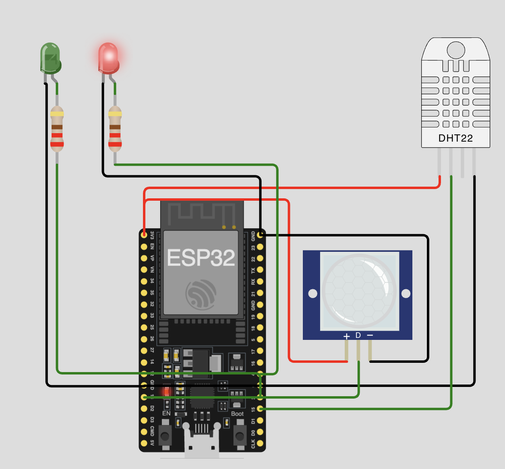
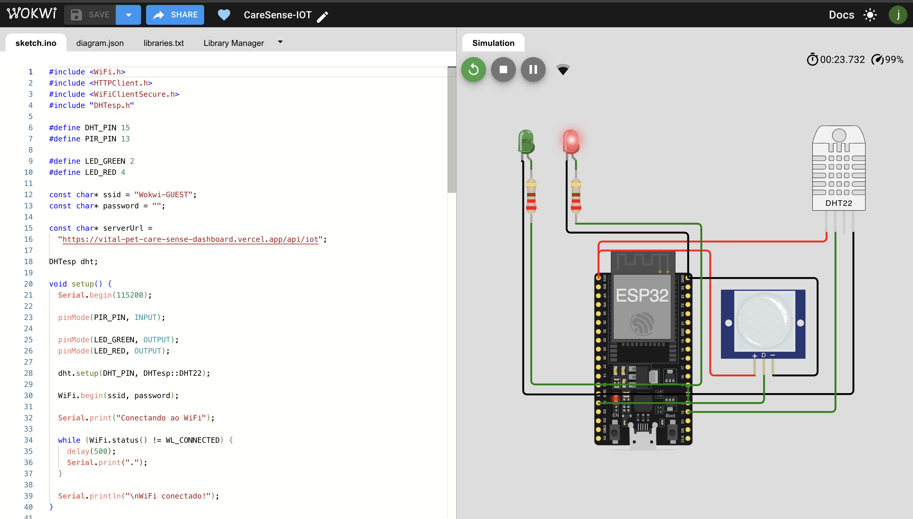

# 🐾 VitalPet CareSense IoT — Sprint 3

## 👨‍💻 Integrantes

- João Victor Alcântara — RM562707
- Phillipo Barbosa — RM565399
- Leonardo Aragaki — RM562944
- Eduardo Martins — RM562259

---

## 📌 Descrição do Projeto

O VitalPet CareSense é uma solução de monitoramento inteligente de ambientes destinados a pets.

A solução combina IoT e análise inteligente para coletar dados ambientais em tempo real, identificar situações potencialmente perigosas e gerar análises contextualizadas considerando as características do animal monitorado.

O protótipo utiliza ESP32, sensor DHT22 e sensor PIR no simulador Wokwi.

---

## 🚨 Problema

Pets podem permanecer em ambientes inadequados sem supervisão do tutor.

Temperaturas elevadas, baixa umidade e a presença do animal em um ambiente crítico podem representar riscos.

Um monitoramento convencional apresenta os valores dos sensores, mas não necessariamente interpreta esses dados considerando também características do animal.

---

## ✅ Solução

O CareSense utiliza sensores conectados ao ESP32 para coletar:

- temperatura;
- umidade;
- presença do animal.

Os dados são enviados via HTTP para a API do Dashboard VitalPet.

No Dashboard, os dados ambientais são combinados com informações do perfil do pet e processados pelo CareSense AI.

A solução permite:

- monitorar temperatura;
- monitorar umidade;
- detectar presença;
- classificar o ambiente;
- enviar dados pela internet;
- integrar ESP32 e aplicação web;
- calcular nível de risco;
- identificar fatores de risco;
- gerar justificativa;
- gerar recomendação contextualizada.

---

## 🧠 CareSense AI

Na Sprint 3, o projeto foi evoluído com um motor de decisão contextual.

A análise utiliza:

### Dados ambientais

- temperatura;
- umidade;
- presença.

### Dados do pet

- nome;
- espécie;
- raça;
- idade;
- peso.

Como resultado, o CareSense AI retorna:

- pontuação;
- nível de risco;
- fatores identificados;
- justificativa;
- recomendação.

---

## 🤖 Abordagem de Inteligência Artificial

O protótipo utiliza uma abordagem de IA simbólica baseada em regras, semelhante a um sistema especialista.

O motor avalia simultaneamente variáveis ambientais e características do animal para determinar uma pontuação de risco.

Entre os fatores analisados estão:

- temperatura elevada;
- baixa umidade;
- presença do animal;
- idade;
- características associadas à raça.

A escolha permite que o protótipo seja explicável e reproduzível: além da classificação, o sistema informa quais fatores contribuíram para o resultado.

A arquitetura também permite evolução futura para modelos de Machine Learning ou modelos generativos.

---

## 🔄 Fluxo de Dados

```text
DHT22 ─────┐
           │
PIR ───────┤
           ▼
         ESP32
           │
           │ HTTP / JSON
           ▼
       API /api/iot
           │
           ▼
    Dashboard VitalPet
           │
           ├── Dados ambientais
           │
           └── Perfil do pet
                    │
                    ▼
              CareSense AI
                    │
       ┌────────────┼────────────┐
       ▼            ▼            ▼
     Risco     Justificativa  Recomendação
                    │
                    ▼
              Dashboard Web
```

---

## 🏗️ Arquitetura

```text
┌─────────────────────────┐
│       Wokwi / IoT       │
│                         │
│ DHT22 + PIR + ESP32     │
└────────────┬────────────┘
             │
             │ HTTP POST / JSON
             ▼
┌─────────────────────────┐
│       API /api/iot      │
└────────────┬────────────┘
             │
             ▼
┌─────────────────────────┐
│    Dashboard VitalPet   │
└────────────┬────────────┘
             │
       Sensores + Pet
             │
             ▼
┌─────────────────────────┐
│      CareSense AI       │
│   Sistema especialista  │
└────────────┬────────────┘
             │
             ▼
┌─────────────────────────┐
│ Nível de risco          │
│ Justificativa           │
│ Recomendação            │
└─────────────────────────┘
```

---

## 🛠️ Tecnologias Utilizadas

### IoT

- ESP32
- DHT22
- PIR Sensor
- LEDs
- Wokwi
- PlatformIO
- Arduino Framework
- C++

### Comunicação

- Wi-Fi
- HTTP
- REST
- JSON

### Dashboard integrado

- Next.js
- TypeScript
- API Routes
- CareSense AI

---

## 🌡️ Sensores

### DHT22

Responsável pela leitura de:

- temperatura;
- umidade.

### PIR

Responsável pela detecção de presença no ambiente.

---

## 🚦 Classificação Local do ESP32

O ESP32 possui uma primeira camada de classificação.

### SEGURO

Condições sem indicadores relevantes de risco.

### ATENÇÃO

O ambiente entra em atenção quando:

```text
temperatura >= 30°C
OU
umidade < 35%
```

### CRÍTICO

O ambiente é classificado como crítico quando:

```text
temperatura >= 33°C
E
presença = true
```

Essa classificação local é independente da análise contextual realizada posteriormente pelo CareSense AI.

---

## 🔌 Comunicação com a API

O ESP32 envia os dados através de uma requisição HTTP `POST` para o endpoint:

```text
/api/iot
```

Exemplo de payload:

```json
{
  "temperatura": 32.5,
  "umidade": 40.0,
  "presenca": true
}
```

O Dashboard recebe esses dados e os disponibiliza para visualização e análise.

---

## 📁 Estrutura do Projeto

```text
VitalPet-CareSense-IoT/
│
├── src/
│   └── main.cpp
│
├── diagram.json
├── platformio.ini
├── wokwi.toml
├── libraries.txt
├── image.png
├── image-1.png
└── README.md
```

---

## ▶️ Como Executar

### 1. Compilar

Com o PlatformIO instalado, execute:

```bash
pio run
```

### 2. Executar no Wokwi

O arquivo `wokwi.toml` utiliza os arquivos compilados pelo PlatformIO:

```text
.pio/build/esp32dev/firmware.bin
.pio/build/esp32dev/firmware.elf
```

Após a compilação, inicie a simulação no Wokwi.

### 3. Simular condições ambientais

Durante a execução é possível alterar:

- temperatura do DHT22;
- umidade do DHT22;
- presença no PIR.

O ESP32 envia periodicamente as novas leituras para a API.

---

## 🧪 Fluxo da Demonstração

```text
Sensores
   ↓
ESP32
   ↓
Classificação local
   ↓
HTTP POST
   ↓
API IoT
   ↓
Dashboard
   ↓
CareSense AI
   ↓
Risco + Justificativa + Recomendação
```

---

## 📷 Evidências

### Circuito ESP32



### Simulação Wokwi



---

## 🔗 Dashboard Integrado

### Repositório

```text
https://github.com/alc-joao/VitalPet-CareSense-Dashboard
```

### Aplicação

```text
https://vital-pet-care-sense-dashboard.vercel.app/
```

---

## 📈 Evolução da Sprint 3

Nesta Sprint, o VitalPet CareSense evoluiu de um sistema de monitoramento IoT para uma solução capaz de interpretar o contexto monitorado.

Foram adicionados:

- motor de decisão contextual;
- perfil do pet como variável da análise;
- pontuação de risco;
- níveis de risco;
- identificação dos fatores considerados;
- justificativa da análise;
- recomendação contextualizada;
- integração entre IoT, API, Dashboard e CareSense AI.

---

## ⚠️ Observação

O CareSense é um protótipo acadêmico de apoio ao monitoramento ambiental e não substitui avaliação ou orientação de um profissional veterinário.

---

## 🐾 VitalPet CareSense

Projeto acadêmico desenvolvido para o Challenge Clyvo — FIAP.
---

## 🎥 Vídeo Demonstrativo — Sprint 3

O vídeo apresenta o funcionamento do VitalPet CareSense, demonstrando a integração entre IoT, Dashboard e CareSense AI.

**Link:** https://youtu.be/0aA5NGLn9Jo
